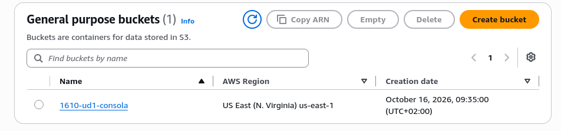
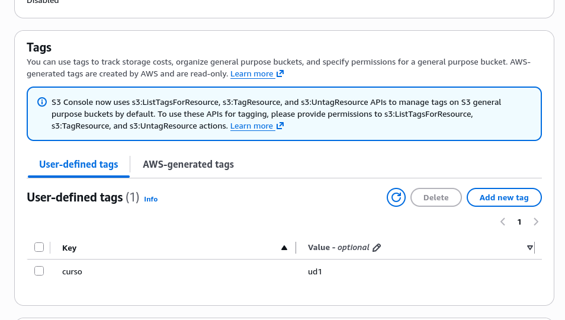
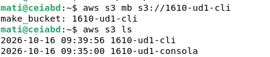
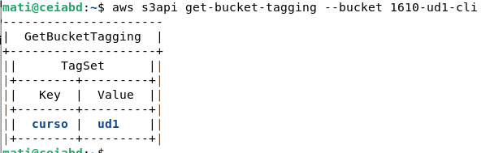
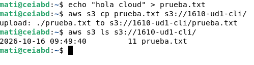
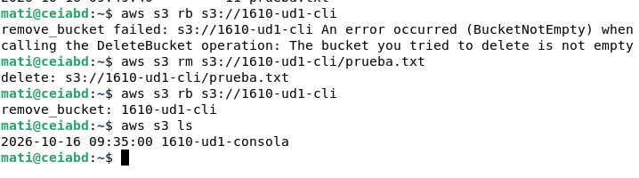

# UD1. Mi primer recurso
**Alumno:** Asier Domínguez
## 1. Laboratorio
- Crédito inicial: 50$
- Crédito final: 50$

## 2. Bucket desde la consola

## 3. Bucket desde la CLI
Creammos el bucket por comandos

Añadimos la etiqueta

Creamos un archivo y lo subimos

## 4. Comparación

| Aspecto | Consola web | CLI |
|---|---|---|
| **Facilidad de uso** | Muy intuitiva | Requiere saber los comandos |
| **Velocidad** | Más lenta, hay que navegar por menús | Más rápida, una sola línea de comando hace la acción |
| **Repetibilidad** | Difícil de repetir igual | Los comandos se pueden guardar y reutilizar |
| **Automatización** | No se puede automatizar | Se puede integrar en scripts |
| **Riesgo de error** | Mas riesgo de equivocarse al hacer clic o configurar opciones | Menor si has probado el comando, aunque un error escribiendo puede fallar todo |
## 5. Reflexión
La consola es visual y guiada, ideal para aprender, mientras que la CLI resuelve cada tarea con una sola línea de comando. Repetirlo veinte veces a mano en la consola sería lento y propenso a errores en nombres, regiones o etiquetas. Con la CLI bastaría con reutilizar los comandos o meterlos en un bucle de un script.
## 6. Evidencia de borrado
Que no vas a poder borrarlo porque hay archivos dentro del S3, primero deberias borrar el archivo y despues borrar 

